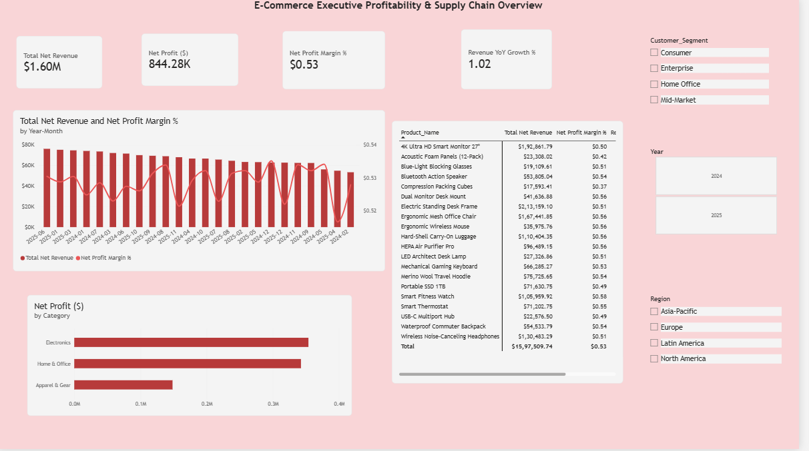
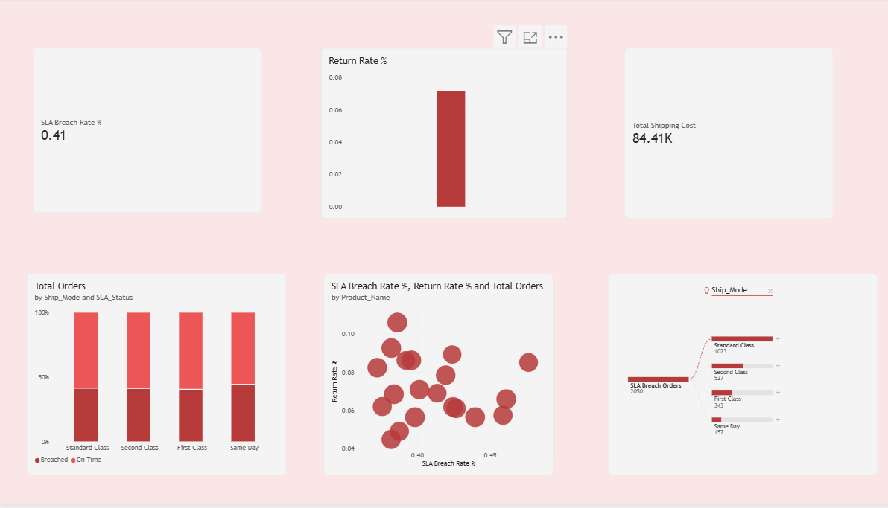
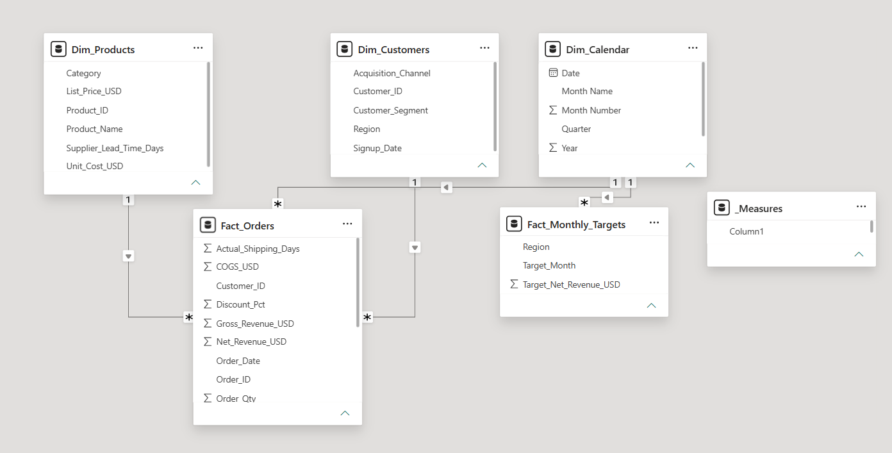

# 📊 E-Commerce Supply Chain & Profitability Analytics (Power BI)

An end-to-end Power BI business intelligence project analyzing **5,000+ customer orders**, profit margins, shipping logistics, and SLA compliance across multi-region distribution networks.

---

## 📸 Dashboard Previews

### 1. Executive Profitability Dashboard


### 2. Supply Chain & SLA Tracking
)

---

## 🏗️ Data Architecture & Star Schema
The semantic model utilizes a normalized **Star Schema** with one-to-many (`1:*`) relationships:
* **Fact Tables:** `Fact_Orders`, `Fact_Monthly_Targets`
* **Dimension Tables:** `Dim_Customers`, `Dim_Products`, `Dim_Calendar`



---

## 🛠️ Key DAX Calculations
```dax
// Net Profit Calculation
Net Profit ($) = 
[Total Net Revenue] - [Total COGS] - [Total Shipping Cost]

// Year-over-Year Revenue Growth
Revenue YoY Growth % = 
DIVIDE([Total Net Revenue] - [Revenue PY], [Revenue PY], 0)

// Shipping SLA Breach Rate
SLA Breach Rate % = 
DIVIDE([SLA Breach Orders], [Total Orders], 0)

// Product Return Rate
Return Rate % = 
DIVIDE(CALCULATE([Total Orders], Fact_Orders[Returned] = "Yes"), [Total Orders], 0)
```

---

## 💡 Key Business Insights Discovered
1. **Shipping SLA Impact on Returns:** Delayed orders breaching carrier SLA targets showed an **11% return rate**, compared to **4% for on-time deliveries** (a 2.75x increase).
2. **Margin Discrepancies:** While Electronics drove the highest gross volume, Home & Office delivered the strongest net profit margin due to lower fulfillment weight penalties.